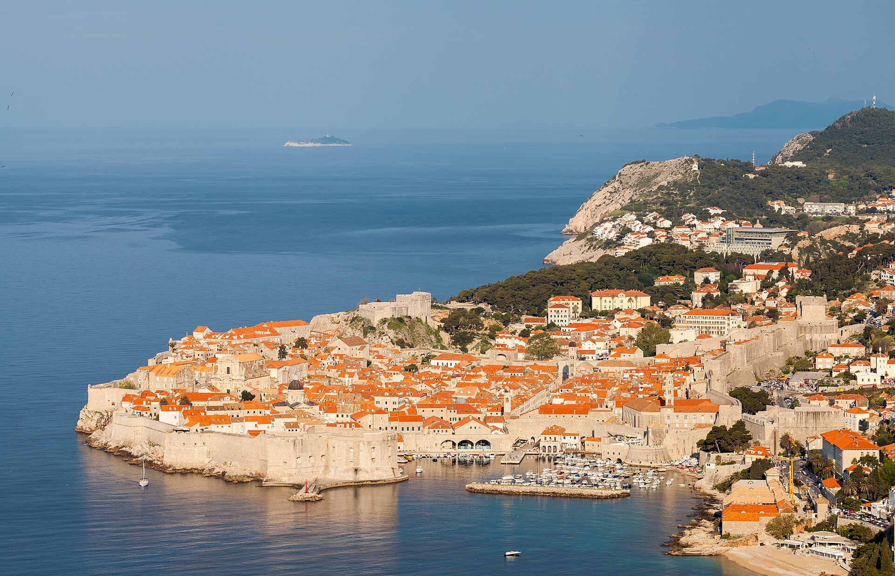

# Visit Croatia — Landing Page

A single-page travel landing page about Croatia, built with **plain HTML, CSS, and vanilla JavaScript** — no frameworks and no build step.



## Features

- **Responsive design** — mobile, tablet, and laptop/desktop layouts using fluid `clamp()` sizing and CSS grid.
- **Photo carousel** — five featured destinations with prev/next arrows, clickable dots, autoplay (5s) that pauses on hover, arrow-key support, and respects `prefers-reduced-motion`.
- **Accordion FAQ** — single-open behavior with an animated panel and accessible `aria-expanded` state.
- **Contact form** — client-side validation (required fields, email format, traveler count), inline error messages linked with `aria-describedby`, and a success message. No backend — submission is simulated.
- **Clickable experience cards** — each card scrolls to the plan form and pre-fills the "interests" field.
- **Accessibility** — skip link, semantic landmarks (`header` / `main` / `footer`), keyboard support, `:focus-visible` outlines, and reduced-motion handling.

## Project structure

```
landing_croatia/
├── index.html      # Page markup (header → main → footer)
├── styles.css      # All styling (mobile-first, responsive)
├── script.js       # Carousel, accordion, form, mobile nav, card pre-fill
├── assets/         # Croatia photos + favicon
│   ├── dubrovnik.jpg
│   ├── plitvice.jpg
│   ├── split.jpg
│   ├── hvar.jpg
│   ├── rovinj.jpg
│   └── hero.jpg
├── package.json
└── README.md
```

## Running it

This is a static site, so you can simply **open `index.html` in your browser** (double-click it or drag it into a browser window). It works fully offline.

Optionally, to serve it over a local web server:

```bash
npm start
```

This runs `npx serve .` and hosts the page at a local URL (e.g. `http://localhost:3000`).

## Interactive components (`script.js`)

| Component        | Behavior |
| ---------------- | -------- |
| Mobile nav       | Hamburger toggle; closes on link click or `Escape`. |
| Carousel         | Autoplay + pause on hover, arrows, dots, keyboard arrows, reduced-motion aware. |
| Accordion        | Single-open; opening one closes the others; animated height. |
| Form             | Validates on submit, live-clears errors, shows a success message, resets. |
| Experience cards | Pre-fill the plan form's "interests" field on click. |

## Tech

- HTML5
- CSS3 (custom properties, grid, flexbox, media queries)
- Vanilla JavaScript (ES6+, no dependencies)
- Google Fonts: Playfair Display + Inter

## Credits

Destination photos are sourced from [Wikimedia Commons](https://commons.wikimedia.org/) under their respective free licenses. This is a demo project for learning purposes.